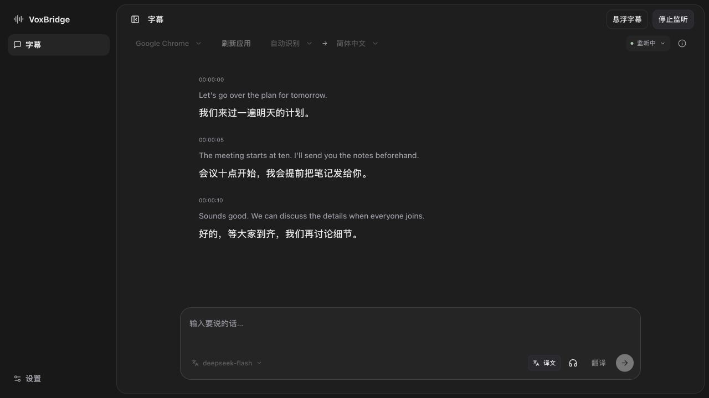

<h1 align="center">VoxBridge</h1>

  <strong>Desktop translation for voice calls on macOS and Windows.</strong> 
  Read bilingual captions, translate copied text, and reply in another language by typing or recording your voice.

  <a href="https://github.com/Zhiruosama/VoxBridge/releases"><strong>Download the beta</strong></a> ·
  <a href="docs/guides/getting-started.md">Setup guide (中文)</a> ·
  <a href="docs/README.md">Documentation (中文)</a>

<a href="README.md">简体中文</a> · <strong>English</strong> · <a href="README.ja.md">日本語</a> · <a href="README.ru.md">Русский</a>

## Installation

Open **Assets** under a beta release on [GitHub Releases](https://github.com/Zhiruosama/VoxBridge/releases) and match the filename ending to your computer.

| Platform | Filename ending | Installation |
| --- | --- | --- |
| Apple Silicon Mac · macOS 14.2 or later | `aarch64.dmg` | Open the disk image and drag VoxBridge into Applications |
| Windows 11 · Intel / AMD | `x64-setup.exe` | Run the installer |
| Windows ARM64 · experimental | `arm64-setup.exe` | Run the installer. Audio hardware validation is pending |

The macOS build lacks Developer ID signing and notarization. Windows installers lack Authenticode signing. The [installation guide (中文)](docs/guides/getting-started.md) covers first-launch prompts. Each release lists the platforms tested.

## First use

In Settings, choose a model and save your own API key for each service you plan to use.

- **Follow a call.** Set up speech recognition and translation. In **Captions**, select Discord or your browser and start listening while the app is playing audio. Open the floating captions to read the original and translation over the call window. [Caption guide (中文)](docs/guides/listening.md)
- **Reply in another language.** Set up translation and speech synthesis. Choose a language and voice at the bottom of the captions window, then type your reply. Preview it in your headphones or send it to the call through a virtual microphone. To dictate a reply, add speech recognition and review the transcript before sending. [Voice setup (中文)](docs/guides/voice-output.md)
- **Translate a passage.** Text translation needs only a translation service. Choose a target language, paste your text and press Enter. To follow along as you read, enable clipboard monitoring and automatic translation, then open the translation window. [Text translation guide (中文)](docs/guides/text-translation.md)

Cloud providers receive the text or audio you submit and may charge for requests. You supply your own keys and service credit. [Model and API key settings (中文)](docs/guides/services.md)

## Help and development

[Troubleshooting (中文)](docs/guides/troubleshooting.md) · [Report an issue](https://github.com/Zhiruosama/VoxBridge/issues) · [Development and packaging (中文)](docs/development.md) · [Architecture (中文)](docs/02-architecture.md)

## License

VoxBridge is source-available. Its own code may be used, modified and distributed for noncommercial purposes under the [PolyForm Noncommercial license](LICENSE). Commercial use requires separate permission. Third-party components retain their own licenses. [Third-party notices](THIRD_PARTY_NOTICES.md)
