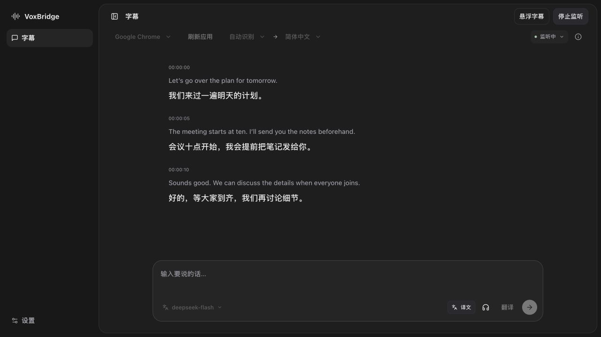

# VoxBridge

**相手の言葉を理解し、自分の言葉も届ける。**

[简体中文](README.md) · [English](README.en.md) · **日本語**

[ダウンロード](https://github.com/Zhiruosama/VoxBridge/releases) · [使い方（中国語）](docs/user-guide.md) · [不具合の報告](https://github.com/Zhiruosama/VoxBridge/issues)

VoxBridge は Mac 向けのリアルタイム音声翻訳アプリです。アプリの音声を原文・訳文の字幕で表示できます。入力したテキストや録音した音声を翻訳・音声合成し、仮想マイクを通じて Discord などのチャットアプリに送ることもできます。

_字幕はサンプルを使用した画面イメージです。_

## できること

- **聞いて読む**：対象アプリを選び、原文と翻訳字幕をリアルタイムで確認。
- **話す・入力する**：録音やテキスト入力に対応。内容を確認してから送信するほか、音声の直接送信も選択可能。
- **字幕を持ち歩く**：デスクトップや全画面表示を切り替えても字幕を表示。フローティングウィンドウから入力・録音も可能。
- **声を選ぶ**：モデル・音声・話す速度を変更し、自分で聞くモニター音声を個別にオン・オフ。

## ダウンロードとインストール

[**0.1.0 テスト版 DMG**](https://github.com/Zhiruosama/VoxBridge/releases/tag/v0.1.0) をダウンロードし、開いたら VoxBridge を「アプリケーション」にドラッグしてください。

インストーラの対象は **Apple Silicon（M シリーズ）搭載 Mac、macOS 14.2 以降**です。開発ツールのインストールは不要です。テスト版は Apple の公証を受けていないため、初回起動時に macOS によってブロックされる場合があります。対処方法は[リリースノート（中国語）](https://github.com/Zhiruosama/VoxBridge/releases/tag/v0.1.0)をご覧ください。

## 使い始める

### 1. サービスを設定する

設定画面で**音声認識・翻訳・音声合成**サービスを選び、ご自身の API キーを入力して保存します。字幕だけを使う場合は、音声認識と翻訳の設定だけで利用できます。保存したキーは再起動後も引き継がれます。

Qwen・DeepSeek・MiniMax などのプリセットと、対応する互換 API を利用できます。サービスの利用料金が発生する場合があり、音声やテキストは選択したサービスに送信されます。詳しくは[サービス設定（中国語）](docs/user-guide.md#服务配置)をご覧ください。

### 2. 翻訳字幕を見る

対象アプリで音声を再生し、VoxBridge でそのアプリを選んでリスニングを開始します。システム音声の録音許可を求められたら許可してください。**フローティング字幕**を開くと、ほかのウィンドウの上に字幕を表示できます。字幕の翻訳先言語は設定画面で変更できます。

### 3. Discord で音声を送る

1. 「設定 → 一般 → オーディオ」で付属の**仮想マイク**をインストールします。管理者の承認が必要です。通話を終了してから行ってください。
2. VoxBridge の**送信デバイス**を VoxBridge に、**モニターデバイス**をシステムデフォルトまたはヘッドホンに設定します。
3. Discord の音声設定で、**入力デバイス**に VoxBridge を選びます。出力デバイスはヘッドホンやスピーカーのままにします。
4. VoxBridge で出力言語を選び、テキストを入力するかマイクボタンで録音して送信します。ヘッドホンボタンで自分へのモニター音声を切り替えられます。

現在は主に Discord で動作を確認しています。QQ・WeChat との互換性は改善中です。音が出ない場合やデバイスが表示されない場合は、[よくある質問（中国語）](docs/user-guide.md#常见问题)をご確認ください。

## 詳しく知る

[使い方の詳細（中国語）](docs/user-guide.md) · [開発とビルド（中国語）](docs/development.md) · [アーキテクチャ（中国語）](docs/02-architecture.md) · [不具合・機能の提案](https://github.com/Zhiruosama/VoxBridge/issues)
