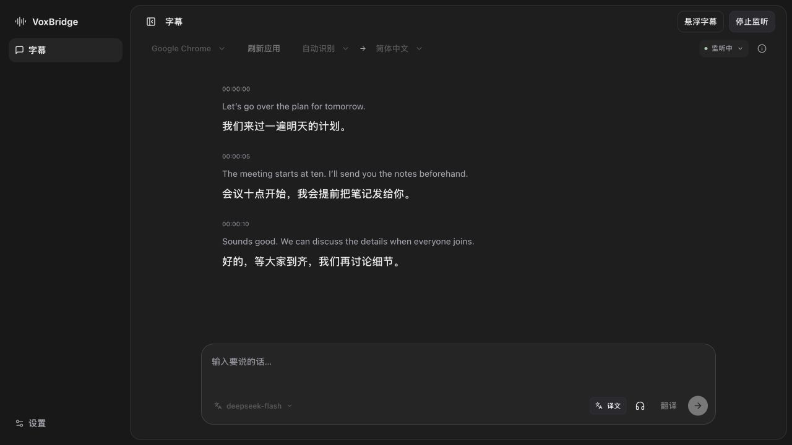

<h1 align="center">VoxBridge</h1>

  <strong>macOS と Windows で使える、音声通話のための翻訳アプリ。</strong> 
  通話の音声を対訳字幕で読み、コピーした文章を翻訳。文字入力や録音で用意した返事を、相手の言語で通話に流せます。

  <a href="https://github.com/Zhiruosama/VoxBridge/releases"><strong>ベータ版をダウンロード</strong></a> ·
  <a href="docs/guides/getting-started.md">導入ガイド（中国語）</a> ·
  <a href="docs/README.md">ドキュメント（中国語）</a>

<a href="README.md">简体中文</a> · <a href="README.en.md">English</a> · <strong>日本語</strong> · <a href="README.ru.md">Русский</a>

## インストール

[GitHub Releases](https://github.com/Zhiruosama/VoxBridge/releases) でベータ版の **Assets** を開き、ファイル名の末尾を確認してください。

| 環境 | ファイル名の末尾 | インストール方法 |
| --- | --- | --- |
| Apple Silicon Mac · macOS 14.2 以降 | `aarch64.dmg` | ディスクイメージを開き、VoxBridge を「アプリケーション」にドラッグ |
| Windows 11 · Intel / AMD | `x64-setup.exe` | インストーラーを実行 |
| Windows ARM64 · 試験対応 | `arm64-setup.exe` | インストーラーを実行。オーディオ機器との互換性は検証中 |

macOS 版は Developer ID 署名・公証を、Windows 版は Authenticode 署名をまだ取得していません。初回起動時の案内は[導入ガイド（中国語）](docs/guides/getting-started.md)、各ビルドの検証範囲はリリースノートをご覧ください。

## はじめて使うとき

設定画面で、使いたい機能に必要なサービスのモデルを選び、ご自身の API キーを保存してください。

- **通話の字幕を読む。** 音声認識とテキスト翻訳を設定します。「字幕」で Discord やブラウザを選び、音声の再生中に「开始监听」を押します。フローティング字幕を開くと、通話画面の上で原文と訳文を読めます。[字幕の使い方（中国語）](docs/guides/listening.md)
- **別の言語で返事をする。** テキスト翻訳と音声合成を設定します。字幕画面の下部で言語と声を選んで返事を入力すると、ヘッドホンで試聴したり、仮想マイク経由で通話に流したりできます。返事を吹き込む場合は音声認識も設定し、送信前に認識結果を確認できます。[音声入力と仮想マイク（中国語）](docs/guides/voice-output.md)
- **文章を訳す。** 必要なのはテキスト翻訳サービスだけです。「文本翻译」で翻訳先の言語を選び、文章を貼り付けて Enter を押します。クリップボードの監視と自動翻訳を有効にすれば、コピーするたびに訳文を小窓で読めます。[テキスト翻訳（中国語）](docs/guides/text-translation.md)

クラウドサービスを使うと、入力した文章や音声が選択した事業者に送信されます。API キーと利用枠はご自身で用意してください。料金は事業者の規定に従います。[モデルとキーの設定（中国語）](docs/guides/services.md)

## サポートと開発

[トラブルシューティング（中国語）](docs/guides/troubleshooting.md) · [不具合を報告](https://github.com/Zhiruosama/VoxBridge/issues) · [開発とビルド（中国語）](docs/development.md) · [アーキテクチャ（中国語）](docs/02-architecture.md)

## ライセンス

VoxBridge はソースコードを公開しています。独自のコードは [PolyForm Noncommercial](LICENSE) の条件に従い、非商用で利用・改変・再配布できます。商用利用には別途許諾が必要です。サードパーティのコンポーネントには各自のライセンスが適用されます。[第三者ライセンスの説明](THIRD_PARTY_NOTICES.md)
