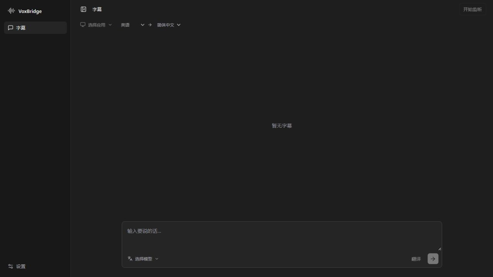

# VoxBridge

面向 macOS 与 Windows 的桌面语音桥接工具：把应用声音转成双语字幕，把文字或自己的语音转成可供聊天软件使用的合成语音。

**最终交付为可安装的桌面应用。** macOS 输出 `.app` / `.dmg`，后续 Windows 输出安装程序。正式应用内嵌界面资源，由本机 Rust 后端运行，不需要浏览器或前端开发服务器；网页入口仅用于开发时检查界面。

> 当前阶段：**macOS 工作台开发版**。已接入翻译、MiniMax / OpenAI 兼容 TTS、指定设备输出、HTTP 分段 / WebSocket 实时 ASR、双语字幕和悬浮字幕。2026-10-23 已用受控播放进程，通过真实 Core Audio 采集 → Qwen ASR → DeepSeek 翻译 → 关联字幕事件验证，并通过 20 次原生启停 / 静音 / 进程隔离检查；旧零电平测试的播放时序已修正。此结果不代表 Discord / 浏览器、GUI 权限恢复、中文准确率、BlackHole 路由或全屏浮窗已验收。MiniMax TTS 已支持有界 PCM 流式播放和真实耳机停止测试；OpenAI 兼容 TTS 仍完整接收后播放，千问实时 WebSocket ASR 的 partial / final 与定稿翻译已通过受控英文采集验证；已支持监听同时进行文字翻译 / 语音输出、网络与采集异常的有界自动恢复；真实 Discord 路由仍待验收。详见[Mac 音频闭环验证](docs/validation/2026-10-23-capture-loop.md)、[实时 ASR 验证](docs/validation/2026-10-23-realtime-asr.md)及[同时收发与自动恢复](docs/validation/2026-10-23-duplex-recovery.md)。

监听入口已改为按已打开的应用选择（如 Google Chrome、微信），同一应用的声音进程自动归并；进程变化沿用有界自动恢复。详见[按应用监听验证](docs/validation/2026-10-23-application-capture.md)。



## 第一版方向

先完成 macOS 版本，保留后续 Windows 适配的架构边界。当前已在 Apple Silicon Mac 开始实机开发和验证；Windows 保留构建与测试检查，尚未接入应用声音采集。

两条核心链路：

```text
听懂：目标应用声音 → 流式语音识别 → 短句翻译 → 双语字幕 / 悬浮窗
表达：输入文字 → 可选翻译 → 流式语音合成 → 虚拟音频设备 → Discord 等应用
扩展表达：真实麦克风 → 语音识别 → 翻译 → 语音合成 → 同一输出链路
```

第一版优先打通“听懂”和“文字表达”；麦克风语音翻译作为随后增量。这里是待评审的默认顺序，不代表用户已确认优先级。

## 功能范围

| 能力 | 第一版计划 | 边界 |
| --- | --- | --- |
| 系统声音识别 | 选择目标应用，识别其播放声音 | 首测 Discord 与一个浏览器；无法承诺所有应用均兼容 |
| 翻译字幕 | 显示原文和目标语言译文 | 默认手动选择源语言和目标语言；先验收中英双向 |
| 悬浮字幕 | 置顶、透明度、字号、拖动、可退出的鼠标穿透 | 全屏和多显示器行为需实机验证 |
| 文字转语音 | 输入、可选翻译、发送、试听、停止 | 试听和发送为明确分开的动作 |
| 虚拟麦克风 | 输出到用户安装的虚拟音频设备 | 原型优先 BlackHole 2ch；不自研或捆绑驱动 |
| 服务设置 | ASR、翻译、TTS 服务及凭据配置 | 首版采用云端服务；本地 ASR 保留接口与评测计划 |
| 麦克风翻译 | 核心链路稳定后加入 | 不作为首个端到端原型的阻塞项 |
| Windows | 保留接口与未来适配计划 | 当前不承诺 Windows 成品可用 |

第一版不包含：声纹克隆、自动代答、自研音频驱动、账号计费系统、完整离线模型管理、商店上架、承诺零延迟的同声传译。

## 技术栈

- **TypeScript + React**：主界面、设置、双语字幕与悬浮窗。
- **Tauri 2 + Rust**：桌面宿主、音频缓冲、会话状态、服务调用与配置管理。
- **少量 Swift / Objective-C 桥接**：macOS Core Audio taps、设备与权限相关能力；以实际构建验证决定桥接语言和实现细节。
- **云端流式 ASR + 文本翻译服务 + MiniMax TTS 候选**：通过独立适配器接入，不把供应商绑定到音频核心。

macOS 原型的建议最低版本为 **14.2**，首测 Apple Silicon；Intel 支持需独立验证。采用 Core Audio taps 的依据及限制见[音频设计](docs/03-macos-audio.md)。

## 阅读与评审

完整入口：[文档目录](docs/README.md)。建议依次阅读：

1. [需求、范围与验收](docs/01-requirements.md)：产品要做什么，第一版做到哪一步。
2. [总体架构与接口](docs/02-architecture.md)：模块边界、数据契约、会话与取消行为。
3. [macOS 音频与设备路由](docs/03-macos-audio.md)：采集、权限、虚拟麦克风与防回环。
4. [AI 流水线、延迟与费用](docs/04-ai-pipeline.md)：模型接入、短句策略、指标和预算控制。
5. [界面与交互](docs/05-product-interaction.md)：页面、操作流程、可恢复错误。
6. [开发阶段与 Mac 验证计划](docs/06-development-validation.md)：Windows 能验证什么，Mac 必须验证什么。
7. [决策与待确认项](docs/07-decisions.md)：已确认约束、推荐方案、未决问题。

## 运行与开发状态

需要 Node.js 22.12+（建议 24）、Rust stable 1.96+；桌面开发还需对应平台的 Tauri 前置依赖。macOS 需 Apple Command Line Tools，Windows 需 Microsoft C++ Build Tools 与 WebView2。

```sh
npm ci
npm start         # 启动桌面开发应用，按当前开发机平台运行
```

在 Mac 上构建应用及安装镜像：

```sh
npm run desktop:build:mac
```

输出位于 `src-tauri/target/release/bundle/`。2026-10-23 已在 Apple Silicon Mac 完成本地 ad-hoc 签名 `.app` 构建及严格签名校验，桌面主窗 / 浮窗已验证受控英文双语字幕及目标退出自动停止；`.dmg`、发布证书签名与公证尚待验证。`npm run dev` / `npm run build` 仅开发或构建界面资源；`npm run desktop:build` 才构建独立桌面应用。

浏览器预览可以体验布局和非敏感配置；密钥保存、真实翻译与设备测试需桌面版。桌面翻译需自备兼容服务的 API 地址、模型 ID 与密钥；设置中的“新增配置”提供 DeepSeek V4.1 Flash 和 MiniMax Speech 2.8 国内服务预设，模型与音色均可编辑。

```sh
npm test
npm run build
cargo test --manifest-path src-tauri/Cargo.toml --locked
```

历史 Windows 验证：前端 9 项测试、Rust 18 项自动测试通过。2026-10-23 Mac 最新验证：前端 65 项测试、Rust 50 项默认测试、格式、严格 Clippy、前端生产构建和 `.app` 构建通过；9 项手动 / 辅助测试默认忽略，其中本轮显式运行了受控音源闭环和 20 次采集启停测试。真实服务测试单独手动运行，不进入默认 CI。真实联调结果见 [2026-10-23 服务验证](docs/validation/2026-10-23-live-providers.md)，不代表实际播放或 Mac 路由通过。Mac 原生探针见 [native/macos](native/macos/README.md)。语音配置和实现边界见 [TTS 开发说明](docs/10-speech-backend.md)。

开发清单：[TODO.md](TODO.md)。详细启动、验证与限制：[开发指南](docs/09-development.md)。暂无可分发安装包。

## 评审补充：模型配置与界面方向

首轮方案已获用户认可，具体服务和实机表现仍待验证。ASR、翻译、TTS 分别配置服务、模型、地址及凭据；翻译优先支持 OpenAI-compatible Chat Completions。相同协议和能力的服务可通过配置更换；不同的流式音频协议仍需对应适配器，不能只凭 API Key 外形判断兼容。详见[模型服务配置与兼容边界](docs/08-provider-configuration.md)。

前端按用户要求参考 Cursor Agent / Codex 的简洁工作台风格：窄侧栏、连续字幕流和底部输入区；无宣传口号、中央引导海报、平台标识或常驻开发状态栏。诊断收纳在设置中；固定字幕示例已移除，保存反馈使用独立圆角浮层。具体设计见[界面与交互](docs/05-product-interaction.md)。

阶段性提交与推送由开发过程自行执行。下一步验收实际应用声音、GUI 权限恢复、TTS 播放 / 停止和 BlackHole 路由，再优化实时 ASR 与流式播放。

密钥现采用“本次使用 / 保存为模板”：手动输入只进入本次内存；已保存密钥模板需在设置中显式解锁，整个应用会话最多一次系统授权尝试。空白配置不会自动选择已有模板。旧版密钥不会后台迁移，详见[会话与模板说明](docs/validation/2026-10-23-session-templates.md)。
