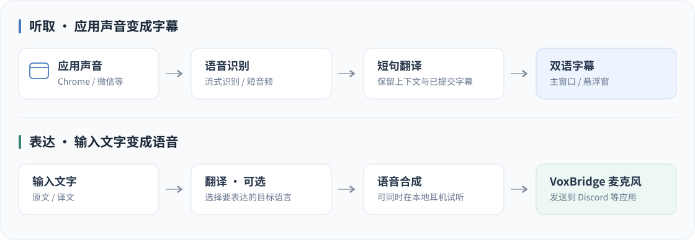

# VoxBridge

应用音频转双语字幕，文字或麦克风语音经翻译后发声。

[](https://github.com/Zhiruosama/VoxBridge/actions/workflows/check.yml)

VoxBridge 是一款桌面语音桥接工具。选择 Chrome、微信等应用，边听边看翻译；写下想说的话，经翻译和语音合成后，通过 **VoxBridge 虚拟麦克风**送入 Discord。

**当前为 macOS 开发版**，主要在 Apple Silicon Mac 上验证，需自备模型服务 API Key。Windows 已纳入构建与自动化检查，应用声音采集尚未接入。仓库暂未提供正式发布安装包，可从源码运行或打包。

[快速开始](#快速开始) · [接入 Discord](#接入-discord) · [开发与验证](#开发与验证) · [文档](#文档)


_使用当前界面组件生成的演示截图，字幕为示例内容。_

## 可以做什么

- **按应用监听**：选择正在运行的应用，自动归并其音频子进程，减少手动选择 PID 的麻烦。
- **实时翻译字幕**：支持流式识别、自然短句切分和并发翻译；已提交的字幕保留，异常时尝试有界恢复。
- **悬浮阅读**：透明置顶字幕窗，macOS 使用原生浮动面板，支持跨桌面及其他应用的全屏空间；支持连续阅读、双语 / 原文 / 译文显示，以及字号、颜色和行距调整。
- **文字表达**：原文与译文统一进入字幕区；支持直接合成原文，或翻译后输出语音，提交发送后清空输入框，输出期间可继续编辑下一段。
- **独立试听**：同一份合成语音可发送到虚拟麦克风，也可同时在耳机播放。关闭试听不会停止发送。
- **同时收发**：监听对方声音时，也能输入文字并输出自己的合成语音。



点击输入框的**麦克风**开始录音，再点击完成，最长 1 分钟，可随时取消。“**直接发送**”开关默认关闭：识别后填入输入框，确认或修改后再发送；开启后，结束录音会自动识别、按目标语言翻译并合成输出。录音时显示随音量变化的动画，不显示倒计时；最长 1 分钟后自动完成。麦克风使用当前语音识别服务，支持 Qwen 实时 WebSocket 和 HTTP 短音频（长录音在较安静处切分请求，再合并文字）；不影响应用声音监听。

悬浮窗**右下角的麦克风按钮**也可直接录音，无需返回主窗口。“直接发送”开启时，结束录音后自动翻译并生成语音；关闭时，可在悬浮窗内修改识别文字，再点击发送。使用当前目标语言、输出设备与试听设置，支持取消录音和停止输出；主窗口未发送的草稿会保留。

在 **设置 → 常规 → 音频 → 语音输入麦克风**选择实体麦克风，默认跟随系统输入。首次录音时 macOS 会请求麦克风权限。录音期间仍可打字，识别结果会追加到当前草稿；如果修改过草稿，开启“直接发送”时也会先等待确认。录音只在内存中处理，不保存音频文件；使用云端识别时，声音会发送给所选服务。

## 快速开始

### 1. 从源码启动

macOS 需要 **14.2+**、Apple Command Line Tools、Node.js **22.12+**（项目 CI 使用 24）和 Rust stable **1.96+**。当前优先验证 Apple Silicon，Intel 尚未单独验收。

```sh
git clone https://github.com/Zhiruosama/VoxBridge.git
cd VoxBridge
npm ci

# macOS：先生成 Tauri 所需的驱动安装包资源，此步骤不会安装驱动
bash native/macos/virtual-mic/build.sh

npm start
```

`npm start` 启动桌面开发应用。正式打包后的应用内嵌前端资源，使用时不依赖浏览器或开发服务器。

### 2. 配置模型服务

打开设置，分别在“语音识别”“文字翻译”“语音合成”中新增服务配置，填写地址、模型和 API Key。可以从内置预设开始，也可以编辑兼容服务。

| 阶段     | 已接入的协议 / 服务                                          | 用途                           |
| -------- | ------------------------------------------------------------ | ------------------------------ |
| 语音识别 | Qwen 实时 WebSocket、Qwen HTTP 短音频                        | 将应用声音转成原文             |
| 文字翻译 | OpenAI-compatible Chat Completions，内置 DeepSeek Flash 预设 | 将字幕或输入文字翻译为目标语言 |
| 语音合成 | MiniMax WebSocket、OpenAI-compatible Speech                  | 将原文或译文合成为语音         |

MiniMax 支持 PCM 流式播放；OpenAI-compatible Speech 当前完整接收后播放。兼容性取决于接口协议与能力，不是填写任意 API Key 就能通用。详见[服务配置与兼容边界](docs/08-provider-configuration.md)。

在 **设置 → 文字翻译 → 前置 Prompt** 中可以编辑当前配置的翻译风格。默认采用适合 Instagram / Discord 聊天的自然口语表达，支持恢复默认；同样用于实时字幕和输入翻译。修改后点击“保存更改”，无需重新输入密钥。

只看字幕时，配置语音识别与翻译即可；要输出合成语音，再配置语音合成和音频设备。云端调用可能产生供应商费用。

### 3. 开始监听

1. 让目标应用播放声音，在工作台选择该应用；未出现时重新展开下拉菜单，或在“设置 → 常规 → 音频”中刷新应用。
2. 语音识别默认自动识别，点击“开始监听”。如需指定输入语言或修改字幕语言，在 **设置 → 常规 → 监听字幕** 中调整。
3. 首次使用时，按 macOS 提示授予所需的系统音频录制权限。
4. 原文与译文会显示在字幕区；点击“悬浮字幕”可放到其他窗口上方阅读。

暂停或结束时点击“停止监听”。关闭悬浮窗不停止监听；关闭主窗口会退出应用并停止任务，黄色窗口按钮用于最小化。

## 接入 Discord

VoxBridge 虚拟麦克风把**合成语音**交给聊天软件。实体麦克风录音经识别、可选翻译后重新合成，不直接转发原始声音。

1. 在 **设置 → 常规 → 音频**点击“安装虚拟麦克风”，完成系统安装器步骤。驱动安装需要管理员授权，会短暂中断系统音频，请先结束通话。
2. 安装后刷新设备，将**发送设备**设为 **VoxBridge**，将**试听设备**设为耳机，并保存。
3. 刷新 Discord 网页，在“语音和视频”中将麦克风设为 **VoxBridge (Virtual)**，扬声器仍使用耳机。`(Virtual)` 是 Discord 的设备类型标注。
4. 调试时先选“**工作室**”输入配置，排除降噪、回音抵消对合成语音的影响，再打开“麦克风调试”测试。
5. 在 VoxBridge 输入文字并发送。输入框的**耳机图标**控制本地试听；使用 Discord 调试回放时可先关闭它，避免重复听到两路声音。

> **发送设备决定对方收到什么，试听设备决定自己听到什么。** 如果发送设备选成耳机，声音只会在本地播放，不会进入 VoxBridge 虚拟麦克风。

同一份合成结果用于发送与试听，切换试听不会重新请求合成。正式通话前请关闭 Discord 的麦克风调试。

输入框旁的语言下拉框决定**语音目标语言**，支持中文、英语、日语、韩语和西班牙语；与设置中的“字幕语言”分别设置，开启监听也不会覆盖语音目标语言。输入已经是目标语言时会在本地识别并直接合成原文，不请求翻译；混合语言或识别不确定时走正常翻译流程。

在 **设置 → 常规 → 工作台字幕配色** 中可分别设置语音识别和主动输入内容的颜色，支持预设色、自定义色和恢复默认；默认保持现有白色样式。主动输入的原文和译文会逐词淡入，动画不延迟语音输出，并遵循系统“减少动态效果”设置。

设备未出现时，先刷新设备列表；仍未刷新可完全退出并重新打开 Chrome。驱动安装、卸载、升级备份和诊断见[虚拟麦克风说明](native/macos/virtual-mic/README.md)。

### 当前兼容性

| 项目                       | 当前状态                                                                                            |
| -------------------------- | --------------------------------------------------------------------------------------------------- |
| macOS 应用声音 → 双语字幕  | 已做受控音源闭环与应用监听验证，实际效果受声音、模型和网络影响                                      |
| VoxBridge → Discord 网页版 | 已验证设备名称、实际语音输入与调试回放；工作室模式改善断续，轻微失真仍待排查                        |
| QQ for macOS               | 重启后仍未列出虚拟设备，暂缓处理，跟踪 [issue #1](https://github.com/Zhiruosama/VoxBridge/issues/1) |
| Windows                    | 构建与自动化检查覆盖，应用声音采集与虚拟麦克风尚未实现                                              |
| 分发与兼容                 | 当前为本机 ad-hoc 签名构建；发布签名、公证、Intel、全屏 / 多屏和长期稳定性仍需独立验收              |

不承诺所有聊天软件兼容，也不将一次成功回放等同于音质或延迟全面验收。当前实测记录见[虚拟麦克风与试听](docs/13-virtual-microphone-and-monitoring.md)。

## 输入与密钥

- **Enter**：默认翻译后输出语音，可在常规设置调整。
- **Shift + Enter**：换行。
- **翻译按钮**：只翻译，结果进入上方字幕区。
- **原文 / 译文**：选择要合成的内容；播放期间可停止当前任务。

输入 API Key 后点击“**保存密钥**”即可持续使用，后续启动自动恢复。密钥使用独立的本机私有凭据目录，与普通设置、localStorage 分开；目录权限 `0700`、文件权限 `0600`（macOS/Linux），加密数据与随机本机加密钥分文件保存。正常保存、读取和重启不访问系统钥匙串，不依赖应用每次打包的签名。

不再提供密钥模板。旧版凭据会尝试无弹窗迁移一次，旧文件保留；迁移成功后不再读取旧凭据。“移除保存的密钥”会持久删除对应密钥，重启不会重新导入。这个方案依靠当前系统用户的文件权限，不隔离同一用户下有文件读取权限的其他程序，详见[存储方式与验证](docs/validation/2026-10-24-private-credentials.md)。

监听的音频会发送到所选识别服务，识别文本会发送到翻译服务，待合成的文字会发送到语音服务。常规运行不自动将原始音频或字幕保存到磁盘；明确执行的开发录音诊断除外。详见[密钥持久化验证](docs/validation/2026-10-24-private-credentials.md)。

## 开发与验证

技术栈为 **React + TypeScript、Tauri 2 + Rust、macOS Core Audio**。虚拟麦克风采用 AudioServerPlugIn，基于 Apple 的 MIT 示例改造；驱动许可与来源见[说明](native/macos/virtual-mic/README.md)。

```sh
# 前端检查与构建
npm run format:check
npm test
npm run build

# macOS：干净检出后，先生成资源并运行驱动回环 / HAL 接口测试
bash native/macos/virtual-mic/build.sh

# Rust 检查
cargo fmt --manifest-path src-tauri/Cargo.toml -- --check
cargo test --manifest-path src-tauri/Cargo.toml --locked
cargo clippy --manifest-path src-tauri/Cargo.toml --all-targets --locked -- -D warnings

# 打包 macOS 应用；自动生成并嵌入驱动安装包
npm run desktop:build -- --bundles app

# 构建 .app 与 .dmg
npm run desktop:build:mac
```

产物位于 `src-tauri/target/release/bundle/`。`.app` 已在本机构建验证；`.dmg` 命令可用，但发行镜像尚未单独验收。真实服务、付费调用和设备测试默认忽略，需显式执行；常规 CI 不会使用开发者密钥或代替真实通话验收。

`npm run dev` 仅启动界面预览，适合检查布局和普通配置；密钥、真实服务调用与音频设备操作需要桌面版。更多平台依赖、原生探针和历史记录见[开发指南](docs/09-development.md)。

## 文档

| 入口                                                             | 内容                                                         |
| ---------------------------------------------------------------- | ------------------------------------------------------------ |
| [文档目录](docs/README.md)                                       | 产品设计、架构与专项说明；部分为早期方案，请结合最新记录阅读 |
| [配置与协议](docs/08-provider-configuration.md)                  | 服务可替换范围和接口约束                                     |
| [实时字幕优化记录](docs/12-streamvox-optimization-progress.md)   | 短句、翻译上下文、恢复与诊断进展                             |
| [虚拟麦克风与试听](docs/13-virtual-microphone-and-monitoring.md) | 当前设备路由、Discord 实测与剩余问题                         |
| [开发清单](TODO.md)                                              | 后续实现与验收事项                                           |
| [问题反馈](https://github.com/Zhiruosama/VoxBridge/issues)       | 缺陷、兼容性反馈与功能讨论                                   |
