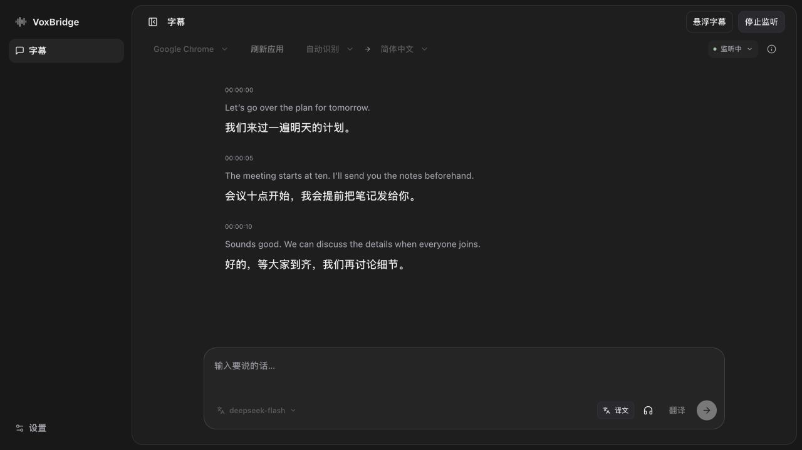

<h1 align="center">VoxBridge</h1>

  <strong>一个用于跨语言通话的桌面翻译工具，支持 macOS 和 Windows。</strong> 
  看双语字幕，翻译复制的文字，把打字或录下的回复用对方的语言说出来。

  <a href="https://github.com/Zhiruosama/VoxBridge/releases"><strong>下载测试版</strong></a> ·
  <a href="docs/guides/getting-started.md">安装指南</a> ·
  <a href="docs/README.md">文档中心</a>

<strong>简体中文</strong> · <a href="README.en.md">English</a> · <a href="README.ja.md">日本語</a> · <a href="README.ru.md">Русский</a>

## 下载安装

在 [GitHub Releases](https://github.com/Zhiruosama/VoxBridge/releases) 展开测试版的 **Assets**，按文件名结尾选择安装包。

| 平台 | 文件名结尾 | 安装 |
| --- | --- | --- |
| Apple Silicon Mac · macOS 14.2 及以上 | `aarch64.dmg` | 打开磁盘映像，将 VoxBridge 拖入「应用程序」 |
| Windows 11 · Intel / AMD | `x64-setup.exe` | 运行安装程序 |
| Windows ARM64 · 实验支持 | `arm64-setup.exe` | 运行安装程序，音频硬件兼容性仍待验证 |

macOS 版尚未完成 Developer ID 签名和公证，Windows 版尚未做 Authenticode 签名。首次打开遇到系统提示时，请参阅[安装指南](docs/guides/getting-started.md)。各版本的验证范围见发布说明。

## 第一次使用

安装后，在「设置」中为要用的服务选择模型并保存自己的 API Key。可以先从下面任一项开始。

- **看通话字幕。** 配置语音识别和文字翻译，在「字幕」页选中 Discord 或浏览器，等应用开始播放声音后点击「开始监听」。打开悬浮字幕，就能在通话窗口上方对照原文和译文。[监听与悬浮字幕](docs/guides/listening.md)
- **用另一种语言回复。** 配置文字翻译和语音合成，在字幕页底部选好目标语言和音色，输入一句话。可以先用耳机试听，再通过虚拟麦克风送进通话。如果想口述回复，再配置语音识别，录完可先核对文字。[语音输入与虚拟麦克风](docs/guides/voice-output.md)
- **翻译一段文字。** 只需配置文字翻译。在「文本翻译」页选好目标语言，粘贴文字并按 Enter。经常边读边译时，可以开启剪贴板监听和自动翻译，在小窗里看结果。[文本翻译](docs/guides/text-translation.md)

使用云服务时，你提交的文字或音频会发送给所选供应商，并按其规则计费。API Key 和服务额度需自备。[模型与密钥配置](docs/guides/services.md)

## 帮助与开发

[声音、权限与服务排错](docs/guides/troubleshooting.md) · [反馈问题](https://github.com/Zhiruosama/VoxBridge/issues) · [本地开发与打包](docs/development.md) · [架构设计](docs/02-architecture.md)

## 许可

VoxBridge 的源码公开，自有代码按 [PolyForm Noncommercial](LICENSE) 许可用于非商业使用、修改和分发。商业用途需另行授权。第三方组件适用各自的许可，详见[第三方许可说明](THIRD_PARTY_NOTICES.md)。
