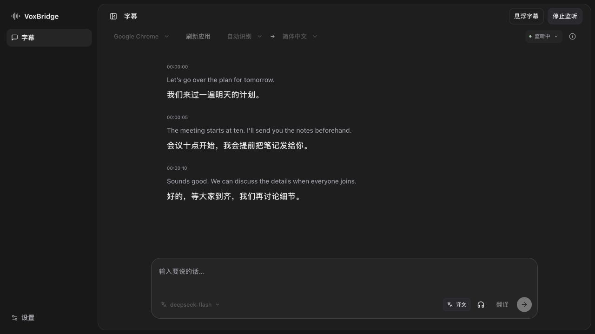

<h1 align="center">VoxBridge</h1>

  <strong>Переводчик для голосовых звонков на macOS и Windows.</strong> 
  Читайте двуязычные субтитры, переводите скопированный текст и отвечайте на другом языке, набрав или надиктовав фразу.

  <a href="https://github.com/Zhiruosama/VoxBridge/releases"><strong>Скачать бета-версию</strong></a> ·
  <a href="docs/ru/guides/getting-started.md">Установка</a> ·
  <a href="docs/ru/README.md">Документация</a>

<a href="README.md">简体中文</a> · <a href="README.en.md">English</a> · <a href="README.ja.md">日本語</a> · <strong>Русский</strong>

## Установка

Откройте **Assets** у бета-версии в [GitHub Releases](https://github.com/Zhiruosama/VoxBridge/releases) и найдите установщик по окончанию имени файла.

| Платформа | Окончание имени файла | Установка |
| --- | --- | --- |
| Mac на Apple Silicon · macOS 14.2 и новее | `aarch64.dmg` | Откройте образ диска и перетащите VoxBridge в «Программы» |
| Windows 11 · Intel / AMD | `x64-setup.exe` | Запустите установщик |
| Windows ARM64 · экспериментальная поддержка | `arm64-setup.exe` | Запустите установщик. Совместимость с аудиооборудованием ещё проверяется |

У сборки для macOS пока нет подписи Developer ID и нотариального заверения, у установщиков Windows — подписи Authenticode. Действия при первом запуске описаны в [инструкции по установке](docs/ru/guides/getting-started.md). Список проверенных платформ и наличие русского интерфейса и распознавания OpenAI уточняйте в описании выбранного выпуска.

## Первый запуск

Чтобы включить русский интерфейс, откройте **Settings → General → Appearance → Interface language** (设置 → 常规 → 外观 → 界面语言), выберите **Русский** и сохраните изменения. Затем выберите модель и сохраните свой ключ API для каждого нужного сервиса.

- **Читайте субтитры во время звонка.** Настройте распознавание речи и перевод текста. В разделе «Субтитры» выберите Discord или браузер и запустите прослушивание, когда приложение воспроизводит звук. Плавающее окно показывает оригинал и перевод поверх окна звонка. [Настройка субтитров](docs/ru/guides/listening.md)
- **Отвечайте на другом языке.** Настройте перевод и синтез речи. Внизу окна субтитров выберите язык и голос, затем введите ответ. Фразу можно прослушать в наушниках или передать в звонок через виртуальный микрофон. Чтобы надиктовать ответ, подключите распознавание речи. Перед отправкой можно проверить текст. [Голосовой ввод и виртуальный микрофон](docs/ru/guides/voice-output.md)
- **Переводите текст.** Достаточно одного сервиса перевода. Выберите язык в разделе «Перевод текста», вставьте фразу и нажмите Enter. Если включить отслеживание буфера обмена и автоматический перевод, переводы скопированных фрагментов будут появляться в плавающем окне. [Перевод текста](docs/ru/guides/text-translation.md)

Для распознавания речи доступны Qwen и модели OpenAI, включая Whisper. Чтобы использовать OpenAI, выберите «Распознавание речи → Добавить конфигурацию → Распознавание речи OpenAI», укажите модель и сохраните ключ. [Модели и настройки OpenAI](docs/ru/guides/services.md#распознавание-речи-openai)

Облачные сервисы получают отправленный текст или аудио и могут взимать плату по своим тарифам. Для работы нужны ваши ключи API и средства на счёте у поставщика, если сервис платный.

## Помощь и разработка

[Устранение неполадок](docs/ru/guides/troubleshooting.md) · [Сообщить о проблеме](https://github.com/Zhiruosama/VoxBridge/issues) · [Разработка и сборка (中文)](docs/development.md) · [Архитектура (中文)](docs/02-architecture.md)

## Лицензия

Исходный код VoxBridge доступен для просмотра. [Лицензия PolyForm Noncommercial](LICENSE) разрешает некоммерческое использование, изменение и распространение собственного кода проекта на её условиях. Для коммерческого использования требуется отдельное разрешение. Сторонние компоненты сохраняют свои лицензии. [Сведения о сторонних компонентах](THIRD_PARTY_NOTICES.md)
