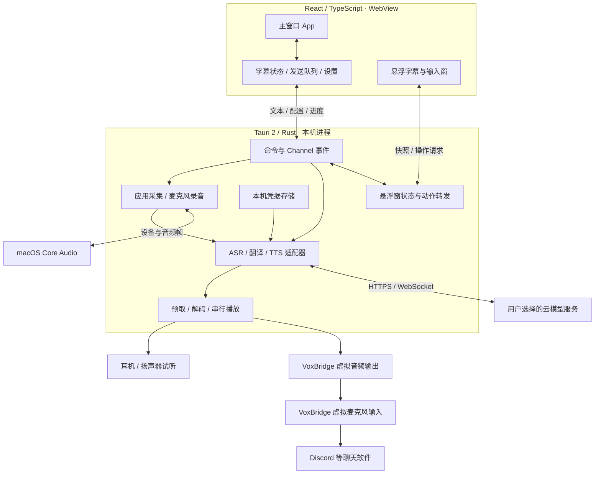
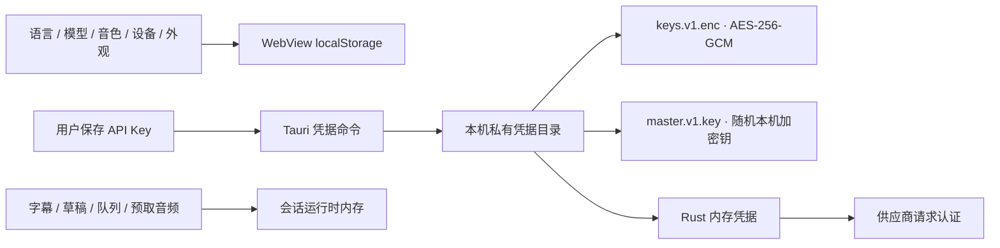

# VoxBridge 架构

[返回首页](../README.md) · [内部流程与状态](internal-flows.md) · [开发与打包](development.md)

本文对应 **0.2.0** 的代码，更新于 2026-10-25。描述已经实现的结构；早期专项文档中的提案不代表当前行为。运行范围以 [0.2.0 发布说明](releases/v0.2.0.md)为准。

## 整体结构

VoxBridge 是本机桌面应用，没有自建账号或模型代理服务。React 显示界面并协调交互，Rust 负责设备、音频、凭据及供应商请求；macOS 音频驱动把合成声音提供给聊天软件。

**两条业务链相互独立：**

- 接收：目标应用声音 → ASR → 翻译 → 双语字幕。
- 发送：文字或麦克风录音 → 可选翻译 → TTS → 虚拟麦克风，可同时本地试听。

监听不会自动把对方声音再合成为语音发回通话。音频帧也不通过 WebView 来回搬运；前端接收的是识别文本、字幕修订、状态和电平等数据。

## 模块与代码入口

| 层次         | 入口                                                                                                                            | 主要责任                                               |
| ------------ | ------------------------------------------------------------------------------------------------------------------------------- | ------------------------------------------------------ |
| 界面协调     | [`src/App.tsx`](../src/App.tsx)                                                                                                 | 监听与录音操作、主窗口状态、队列和悬浮窗协作           |
| 前端领域逻辑 | [`src/core/`](../src/core/)                                                                                                     | 字幕修订、发送队列、配置解析、语言和输出路由           |
| 桌面桥接     | [`src/bridge.ts`](../src/bridge.ts)、[`lib.rs`](../src-tauri/src/lib.rs)                                                        | Tauri 命令、长任务 Channel、后端状态注册               |
| 应用声音采集 | [`capture.rs`](../src-tauri/src/capture.rs)、[`platform/macos_capture.rs`](../src-tauri/src/platform/macos_capture.rs)          | 按应用选择声音源、Core Audio process tap、采集生命周期 |
| 监听流水线   | [`capture/listening/`](../src-tauri/src/capture/listening/)                                                                     | 音频处理、实时或 HTTP ASR、字幕提交、翻译调度与恢复    |
| 主动录音     | [`microphone.rs`](../src-tauri/src/microphone.rs)                                                                               | CPAL 麦克风输入、60 秒上限、录音状态、识别结果         |
| 模型适配     | [`asr.rs`](../src-tauri/src/asr.rs)、[`providers.rs`](../src-tauri/src/providers.rs)、[`speech.rs`](../src-tauri/src/speech.rs) | ASR、翻译、TTS 的协议与结果校验                        |
| 播放与预取   | [`speech/`](../src-tauri/src/speech/)                                                                                           | 流式 PCM、完整音频解码、内存预取、本地试听与取消       |
| 悬浮窗       | [`overlay.rs`](../src-tauri/src/overlay.rs)、[`overlay/`](../src-tauri/src/overlay/)                                            | 快照校验与广播、动作转发、macOS 浮窗行为               |
| 凭据         | [`credentials.rs`](../src-tauri/src/credentials.rs)、[`credentials/`](../src-tauri/src/credentials/)                            | 私有文件存储、加密、内存读取与旧数据迁移               |
| 虚拟麦克风   | [`native/macos/virtual-mic/`](../native/macos/virtual-mic/)                                                                     | 独立的 AudioServerPlugIn、构建检查与安装器             |
| 界面语言     | [`src/i18n/`](../src/i18n/)                                                                                                     | 中英文 UI 文案；不改写字幕内容、模型参数和用户预设名   |

`App.tsx` 仍承担较多协调逻辑。表中的职责是现有文件的分工，不表示已经实现一套独立的 SessionController 服务或通用插件框架。

## 线程与通信边界

| 通道                   | 传递内容                                     | 约束                                               |
| ---------------------- | -------------------------------------------- | -------------------------------------------------- |
| React → Rust `invoke`  | 服务配置、文本、设备标识、开始/停止请求      | 密钥保存是独立命令，普通配置不包含 API Key         |
| Rust → React `Channel` | `ListeningEvent`、`SpeechProgress`、录音进度 | 按会话、请求和代次过滤晚到事件                     |
| Rust 窗口事件          | 字幕快照、录音/发送快照、浮窗动作            | 使用版本号，启动时可读取当前快照                   |
| 原生采集 → 后台处理    | 有界音频帧缓冲                               | 回调不执行供应商网络请求；满时不能无限增长         |
| Rust → 云服务          | ASR 音频、待翻译文本、TTS 文本               | 按配置选择协议，云服务的费用与数据政策由供应商决定 |
| 系统音频 → 虚拟驱动    | 合成后的声音                                 | 驱动本身不联网、不识别、不翻译                     |

普通设置由 WebView 的本地存储持久化。后端初始化和服务请求读取本机凭据；前端只查询“是否已配置”，不取回已保存的密钥明文。

## 配置和数据放在哪里

- [`settings.ts`](../src/core/settings.ts) 使用 `voxbridge.settings.v1` 保存非敏感设置，并在读取时补齐新增字段、过滤和约束输入。
- [`credentials/store.rs`](../src-tauri/src/credentials/store.rs) 与 [`crypto.rs`](../src-tauri/src/credentials/crypto.rs) 管理凭据文件。macOS / Linux 使用目录 `0700`、文件 `0600`；正常保存和重启读取不依赖 Keychain。旧版迁移路径另见[凭据记录](validation/2026-10-24-private-credentials.md)。
- 加密文件和解密钥都在同一用户的本机目录。此设计保护文件权限与误提交场景，**不能隔离有权读取这两个文件的同用户程序**，也不是硬件密钥库。
- 字幕历史最多保留 500 条；正常使用不把录音、字幕历史或预取语音写入聊天历史文件。手动运行的诊断录音工具另当别论。
- 界面语言、识别语言、字幕目标语言、主动输入目标语言分别控制不同环节。改变英文界面不等于把翻译目标改成英语。

## 设备、权限和发行边界

应用采集使用 macOS Core Audio process tap；主动录音使用麦克风输入。两种权限不同，不能通过同一个开关互相替代。设置页设备枚举只读 Core Audio 属性，不初始化麦克风输入流。

试听选择“系统默认”时保留的是跟随模式，实际输出设备在播放时解析；虚拟麦克风发送设备独立选择，不修改系统默认麦克风。

发行包由 Tauri 将前端资源与 Rust 可执行程序打成 `.app`，内嵌虚拟麦克风安装器，再生成 DMG。用户不需要 Node.js、Rust 或 Homebrew。安装驱动是额外的系统安装步骤，需要管理员授权。

0.2.0 提供 Apple Silicon / macOS 14.2+ 测试包，尚未 Developer ID 签名或公证。Windows 有部分条件编译与界面代码，但当前没有完成应用声音采集和虚拟麦克风接入。QQ、微信的设备枚举兼容性也不能从 Discord 测试结果直接推断。

## 继续阅读

- [本机诊断日志](diagnostics.md)：0.2.1 之后主分支新增的日志范围、导出与排查方式。

- [内部流程与状态](internal-flows.md)：分句、翻译、队列、取消、自动恢复和浮窗协作。
- [开发与打包](development.md)：运行命令、测试与发布工作流。
- [虚拟麦克风实现](../native/macos/virtual-mic/README.md)：驱动的格式、路由和安装。
- [实时字幕优化记录](12-streamvox-optimization-progress.md)、[语音输出记录](13-virtual-microphone-and-monitoring.md)：具体改动和验证边界。
