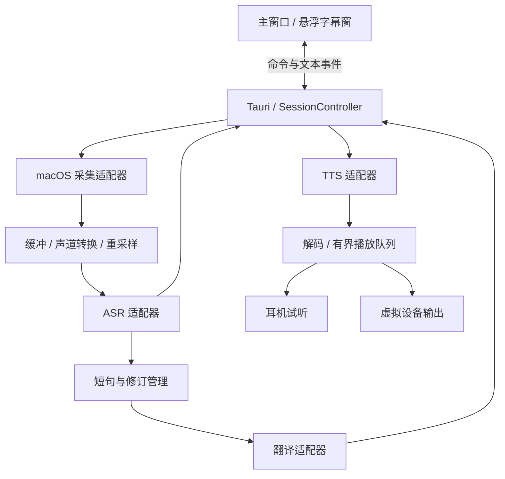

# 总体架构与接口设计

## 1. 技术提案

采用 Tauri 2 + React / TypeScript + Rust。macOS 原生模块通过窄接口桥接 Core Audio；Swift / Objective-C 具体选择在 Mac 构建探针后确定。Python 仅用于离线评测等工具，不作为首版运行时依赖。

理由：界面与平台解耦，Rust 负责并发与音频队列；未来 Windows 替换平台适配器即可复用上层流程。代价是多语言构建和桥接调试，需要在早期验证，而非到打包时才处理。

## 2. 模块与数据流



音频不经前端 WebView 转运。原生回调只写入有界缓冲区，不执行网络请求、重采样、JSON 序列化或阻塞等待。Rust 后台任务负责处理与服务连接。

## 3. 模块责任

| 模块 | 责任 | 不负责 |
| --- | --- | --- |
| SessionController | 启停、会话代次、取消、错误汇总 | 供应商私有消息解析 |
| AudioSource | 应用 / 麦克风枚举、采集帧、设备状态 | 识别与翻译 |
| AudioProcessor | 重采样、声道转换、帧批次 | 产品设置页面 |
| AsrProvider | 输入音频、输出 partial / final | 直接更新字幕 DOM |
| SegmentManager | 句子标识、修订、去重、翻译提交 | 音频设备控制 |
| TranslationProvider | 文本与短上下文转译 | 自动发送语音 |
| TtsProvider | 流式合成、格式声明、取消 | 选择系统默认麦克风 |
| AudioSink | 解码后播放、输出设备选择、清空 | 翻译文本 |
| Settings / CredentialStore | 配置持久化、凭据引用 | 记录原始音频 |

## 4. 拟议数据契约

以下是语言无关契约，具体类型在实现时定义：

| 对象 | 必需字段 | 约束 |
| --- | --- | --- |
| AudioFrame | session_id、sequence、capture_time、sample_rate、channels、format、samples | 时间为单调时钟；采样格式显式传递 |
| TranscriptEvent | session_id、segment_id、revision、text、is_final、start_ms、end_ms | 时间相对当前会话；修订号递增 |
| TranslationEvent | session_id、segment_id、source_revision、text、status | 旧修订的返回不能覆盖新译文 |
| SpeechJob | job_id、generation、text、language、voice、route | route 必须为 preview 或 send |
| AudioChunk | job_id、generation、sequence、sample_rate、channels、encoding、data | 压缩音频先解码；顺序交付 |
| PipelineError | code、stage、recoverable、user_message、correlation_id | 不含密钥和整段用户内容 |

平台接口：`list_sources`、`list_devices`、`start_capture`、`stop_capture`、`start_output`、`write_output`、`stop_output`。设备用稳定 UID 绑定；运行时 ID 变化需重新解析，进程 ID 不跨启动持久化。

服务配置采用 ProviderProfile，由阶段绑定 profile_id；协议适配器与模型名称分离。翻译的 OpenAI-compatible Chat Completions、MiniMax 原生 TTS 和各家流式 ASR 分别实现适配器。统一能力描述及配置生效规则见[服务配置设计](08-provider-configuration.md)。

前端命令：`start_listening`、`stop_listening`、`submit_speech`、`stop_speech`、`update_settings`、`set_overlay`。事件包括会话状态、识别更新、翻译更新、电平、发送状态与错误。命令返回“已受理”不等于播放完成；完成以状态事件为准。

## 5. 状态、并发和背压

监听会话：`idle → starting → listening → stopping → idle`；任何阶段可转 `error`，清理资源后允许重试。发送任务：`queued → translating? → synthesizing → playing → completed`，可转 `cancelled / failed`。开始播放时可能仍在合成后续音频，状态应同时保留合成与播放进度。

- 接收与发送使用独立任务和取消令牌；停止监听不自动中断正在发送的语音。
- 初期同一输出路由只允许一个任务；忙时禁止重复发送，用户先停止再发送，不累积长队列。
- 停止发送先提升 generation、清空播放缓冲，再取消网络任务；旧任务即使晚到也直接丢弃。
- 停止监听使 session_id 失效；晚到的识别 / 翻译不进入新会话。
- 采集缓冲建议上限 2 秒；溢出标记丢帧并重置受影响识别流，不阻塞原生回调。最终值经实测调整。
- 翻译并发默认 2、待处理短句默认 8；满时标记未翻译并提示落后，保留原文，不无限排队。恢复后不自动补译大量历史。
- TTS 预缓冲初值约 150 毫秒、播放缓冲上限建议 5 秒；满时暂停消费（协议支持时），否则中止任务并提示，不能无限占内存。

## 6. 配置、隐私与凭据

- 非敏感配置保存语言、设备 UID、窗口状态、服务类型与模型 ID，携带 schema_version 便于迁移。
- API 密钥由 Rust 侧保管，目标存入 macOS Keychain；前端只收取首次输入并立即提交，后续仅显示“已配置”，不回传密钥。具体 Keychain 库待工程验证。
- 日志默认只记录耗时、错误码、音频格式和队列指标；不记录原始声音、字幕、输入文本、认证头。
- 默认不落盘录音和聊天历史；字幕只保留当前会话有界历史，建议最多 500 条。诊断导出需用户显式操作并预览内容。
- 云端模式首次启用时说明声音 / 文本将发送至所选服务。服务日志保留政策由具体供应商决定，应用不宣称端到端完全离线。
- 原型采用用户自带 API Key，不引入账号服务。若将来统一付费凭据，须另设后端，不能把共享密钥打包进客户端。

## 7. 拟议工程目录

```text
src/                         # React 主界面、字幕窗、类型
src-tauri/src/
  session/                   # 状态、取消、事件
  audio/                     # 帧、重采样、播放队列
  providers/                 # ASR、翻译、TTS 契约与适配器
  platform/macos/            # 原生桥接入口
  settings/                  # 配置与凭据
native/macos/                # 必要的 Swift / Objective-C 实现
fixtures/                    # 可公开测试语料与模拟事件
docs/                        # 当前设计文档
```

这是未来结构建议，本轮不创建空代码目录或伪实现。
