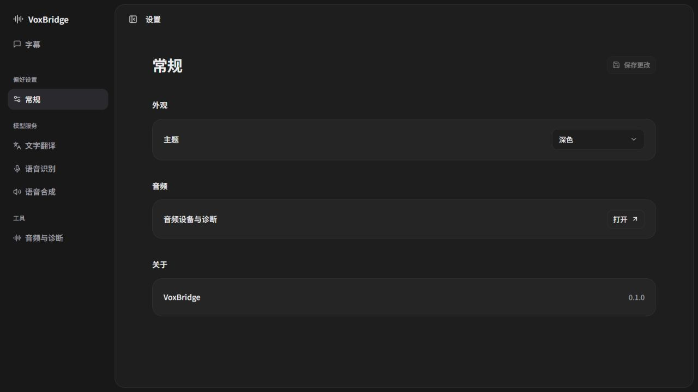

# 界面与交互设计

## 0. 桌面应用与简洁视觉方向

最终交付是可安装桌面应用，macOS 生成 `.app` / `.dmg`。Tauri 内嵌界面资源并连接本机 Rust 后端；浏览器预览只是开发工具，不是软件交付形态。

根据用户 2026-10-22 截图标注修订，参考 Cursor Agent / Codex 的克制工作区布局，遵循：

- 侧栏仅保留品牌名称、“字幕”和“设置”；诊断收进设置，固定字幕示例按最新反馈移除。
- 主区域只有紧凑的采集源 / 语言选择、连续双语字幕，以及底部输入区。
- 空状态仅显示“暂无字幕”，不放品牌口号、英文标语、中央宣传海报或引导按钮。
- 不展示“浏览器预览”“开发预览”、版本徽标、macOS 优先、隐私标语等常驻说明。
- 不设底部状态栏，不重复显示会话名称、字幕类型或输入区标题。
- 未完成能力仍明确禁用，通过控件提示与诊断页解释原因；不把演示伪装为监听。
- 只有正在执行的任务显示停止入口，保存成功短暂反馈；错误可见且可恢复。

深色背景 `#1E1E1E`、侧栏 `#181818`、输入区 `#252525`，中性灰文字和细边框，主操作使用灰白色。内置 Noto Sans SC 可变字体，不依赖网络字体；正文 14 px / 450，控件 13–14 px / 500，导航 550、标题 600–650，译文 17 px / 500。浅色与跟随系统继续保留。

根据用户后续字体与圆角反馈，统一使用自定义下拉浮层替代系统原生下拉框：菜单圆角 14 px、选项圆角 8 px，选中勾号、悬停高亮，支持方向键、输入匹配、Esc 与焦点恢复。主面板圆角 18 px、输入容器 20 px、普通控件 10 px，发送按钮为圆形。菜单仅在展开时短暂淡入，并尊重减少动画设置。

```text
┌──────────┬───────────────────────────────────────────┐
│ VoxBridge│ 字幕                             开始监听 │
│ 字幕     │ 选择应用    英语 → 中文                    │
│          │                                           │
│          │              暂无字幕                     │
│          │                                           │
│          │ ┌───────────────────────────────────────┐ │
│          │ │ 输入要说的话…                         │ │
│ 设置     │ │ 选择模型                     翻译  →  │ │
└──────────┴─┴───────────────────────────────────────┴─┘
```

以上为当前实现方向，完整产品能力仍按下文逐步接入。保持系统原生窗口控制，窄窗口可折叠侧栏；悬浮字幕窗在后续单独实现，不放未实现的预览入口占用主界面。

## 1. 主窗口

主窗口分为三个区域：

| 区域 | 内容 | 核心操作 |
| --- | --- | --- |
| 接收与字幕 | 采集应用、源 / 目标语言、原文 / 译文、电平和状态 | 开始、暂停、显示悬浮窗 |
| 表达 | 文字输入、翻译开关、输出语言、音色、当前路由 | 试听、发送、停止 |
| 设置与诊断 | 服务凭据、耳机与虚拟设备、权限检查、用量估算 | 检查连接、测试设备、导出诊断 |

监听和发送有独立状态，避免用一个“运行中”掩盖另一条链路失败。主窗口明确显示当前声音采集对象和发送目的地。

## 2. 首次配置流程

1. 显示当前原型支持范围与云端数据流说明。
2. 选择服务并配置凭据，检查账号 / 网络连接；不自动消耗大段音频做测试。
3. 选择源 / 目标语言和要监听的应用。
4. 点击开始监听时再请求系统音频权限，并显示电平与字幕。
5. 使用发送功能前检查 BlackHole，缺失时显示安装帮助；字幕功能仍可使用。
6. 选择真实耳机作为试听输出，选择 BlackHole 作为发送输出。
7. 引导用户在 Discord 选择 BlackHole 输入、真实耳机输出，先试听再发送短句测试。

设备测试会实际播放声音，按钮明确标明“试听到耳机”或“发送测试语音”，不在页面打开时自动播放。

## 3. 字幕与悬浮窗

- 每句原文与译文成对展示，正在识别的原文有轻量状态标记。
- 翻译延迟或失败保留对应句位置，不能把下一句译文错配到上一句。
- 默认自动跟随最新字幕；用户上滚阅读时暂停跟随，提供“回到最新”。
- 悬浮窗默认双语，支持字号、透明度、位置和显示 / 隐藏；配置可持久化。
- 开启鼠标穿透后，通过主窗口或菜单入口关闭；不能让用户失去控制。
- 隐藏悬浮窗不等于停止采集，界面必须明确提示。关闭主窗口默认结束采集和发送并退出应用；若以后改为后台运行，需明确的产品设计与状态提示。

## 4. 文字表达

- 输入为空时禁止试听 / 发送；超过限制时提示可用字数。
- 试听只进入真实耳机，发送只进入虚拟设备。原型不提供隐式的“同时试听并发送”。
- 合成 / 播放期间禁止重复发送；停止始终可用。
- 翻译开启时显示目标语言，并展示所得译文；首版按一次发送完成翻译后直接合成，不额外插入逐次确认弹窗。
- 更换输出路由时先停止当前播放再应用；不能将正在说的一句话突然送到新设备。
- 修改输入不改变已提交任务；下一次发送才使用新文本。
- 未配置虚拟设备时禁用发送并提示配置原因；试听可正常使用。

## 5. 错误与恢复文案方向

| 错误 | 界面反馈 | 恢复动作 |
| --- | --- | --- |
| 系统音频权限不足 | 无法读取所选应用声音 | 打开设置引导，授权后重试 |
| 有权限但无声音 | 未检测到所选应用音频 | 检查应用是否播放、是否选对进程 |
| ASR 断线 | 识别已中断，标记字幕断档 | 重连状态可见，停止始终可用 |
| 翻译失败 | 此句暂未翻译，原文保留 | 手动重试 |
| 认证失败 / 余额不足 | 明确对应服务不可用 | 修改凭据或账户处理后重试 |
| 虚拟设备缺失 | 暂时无法向聊天软件发送声音 | 安装 / 选择设备 |
| 发送中设备断开 | 已停止发送 | 重新选择设备并手动发送 |
| 处理落后 | 部分内容未翻译 / 已发生识别断档 | 暂停、缩短上下文或更换服务 |

文案面向用户说明发生了什么与下一步，不展示认证头、堆栈或供应商原始报错全文。

## 6. 可用性要求

关键按钮可键盘访问；状态不只依赖颜色；字幕文字对比度与字号可调整。首版不占用全局快捷键，避免与 Discord 冲突。麦克风增量上线后再定义按住说话的快捷键与焦点行为。

## 7. 模型服务设置

ASR、翻译、TTS 各有服务配置页签，展示服务名称、协议类型、API 地址、凭据状态和模型 ID。翻译支持“OpenAI 兼容”配置；语音页只展示该适配器支持的模型、音色与音频参数。

支持保存多个配置并为每个阶段选择活动配置。模型列表可按需读取，但手动填写模型 ID 始终可用；列表失败不代表服务不可用。“检查连接”与“测试翻译 / 识别 / 合成”区分展示，后者可能计费，必须显式点击。切换模型或服务时说明下次任务生效；监听期间修改 ASR 后需停止再重新开始。

## 8. 设置工作区布局

沿用主工作台的字体、圆角和下拉菜单，参考用户提供的设置页截图：

- 进入设置后，左侧显示“常规 / 文字翻译 / 语音识别 / 语音合成 / 音频与诊断”分类，保留返回字幕入口。无需叠加第二层侧栏。
- 常规页按外观、音频、关于分组；服务页按连接、访问凭据分组，使用圆角容器与细分隔线。
- 每行左侧为名称，右侧为输入框、选择器或按钮，不放重复的说明小字；窄内容区自动改为上下排列。
- API / 模型占位符采用标准地址和标识格式；配置名称通过当前配置旁的编辑按钮内联修改，不重复占一行。
- 标题与保存按钮随内容滚动保持可见；没有修改时禁用保存，存在修改时显示“未保存”。
- 同一设置工作区内切换常规与模型分类保留草稿；离开到字幕 / 诊断后未保存内容仍按既有规则放弃。
- 密钥单独即时保存，不与普通设置混写；凭据操作期间暂时禁止分类切换，避免异步结果错配。
- 工作台的模型选择入口直接进入文字翻译设置；普通设置入口默认打开常规页。



输入区聚焦时仅突出整个圆角容器，文本框自身无独立蓝色描边、底部横线或拖动手柄；普通输入字段也使用中性灰焦点样式。开发联调步骤保留在文档中，固定字幕示例已移除。

保存操作使用顶部居中的圆角悬浮提示，不推挤页面内容，支持关闭并在短暂显示后自动消失。诊断页提供明确的保存入口，保存的试听设备与常规设置保持同步；设备缺失时标记不可用，不自动改为系统默认输出。
