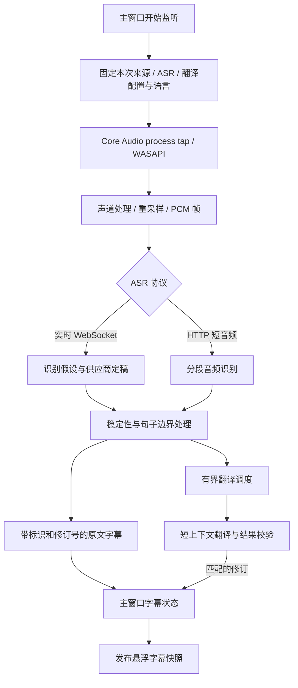
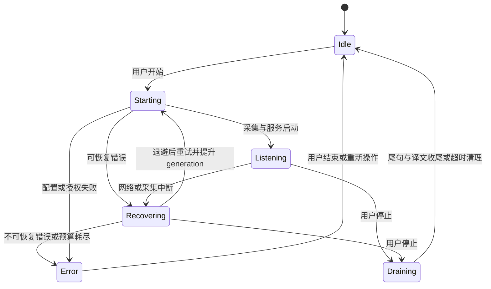
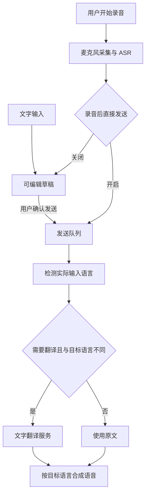
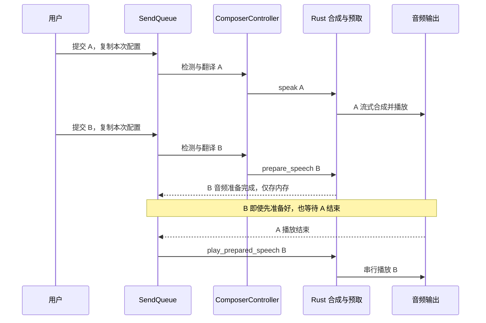
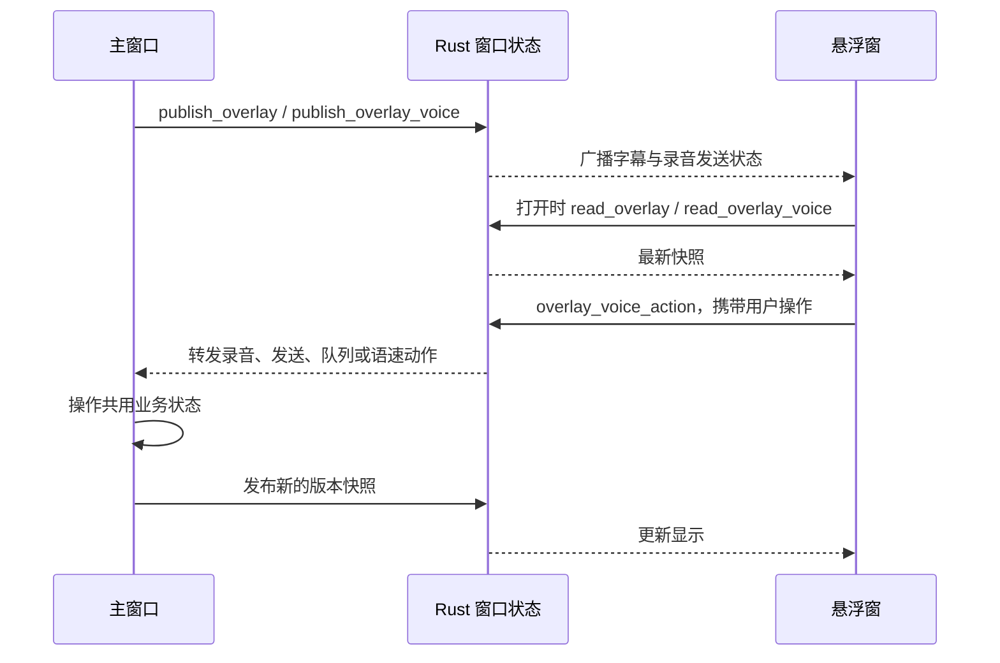
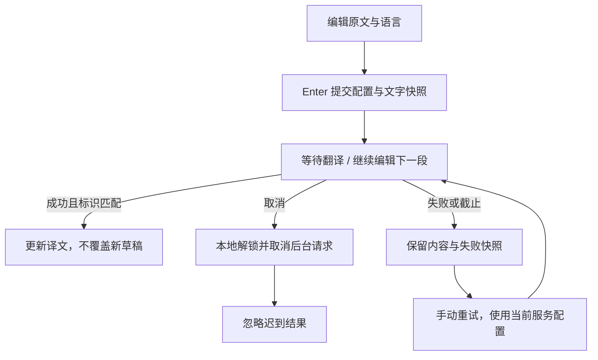

# 内部流程与状态

[架构总览](02-architecture.md) · [开发与打包](development.md) · [使用指南](user-guide.md)

本文说明当前实现的状态与边界。图中的节点是处理步骤，不一定各自对应一个进程或线程。数值来自当前代码，是资源限制或策略参数，不是对所有模型和网络环境的延迟保证。

## 1. 监听应用声音，生成字幕

### 为什么不直接用 ASR 的每次返回当一条字幕

实时 ASR 的 partial 会反复修正，也可能在一次供应商定稿里返回多个句子。因此字幕提交层要处理稳定文本、句子边界与剩余片段，而不是每隔固定时间切一段，也不是始终等待一整段长发言结束。

主要代码：

- [`asr/realtime.rs`](../src-tauri/src/asr/realtime.rs)：实时协议消息与识别结果。
- [`capture/listening/realtime/chunks.rs`](../src-tauri/src/capture/listening/realtime/chunks.rs)：字幕片段提交逻辑。
- [`capture/listening/realtime.rs`](../src-tauri/src/capture/listening/realtime.rs)：采集、识别事件和提交层的连接。
- [`translations.rs`](../src-tauri/src/capture/listening/realtime/translations.rs)：有界翻译调度与耗时指标。

识别阶段可以先显示原文，译文稍后更新同一条字幕。`sessionId` 区分监听会话，`segmentId` 标识字幕，`revision` 区分修订；前端 [`session.ts`](../src/core/session.ts) 校验事件是否仍属于当前字幕版本。不能仅凭“哪个请求最后返回”决定覆盖哪条译文。

当前供应商识别段保留最近八条已提交字幕的边界。临时修订不反复覆盖历史；供应商定稿与这些字幕不同时，通过显式 `correction` 事件提升原字幕修订号，保持位置、时间和段落身份，并清除旧译文重新翻译。被撤回的字幕可删除。更早的字幕与上一供应商识别段不参与纠正，避免无限回溯。纠正时清空后续翻译参考窗口，避免继续引用已知错误。

翻译排队项共享源修订标记：已过期的排队任务直接跳过；已在途的请求允许结束，但其成功或失败均不能覆盖新修订或中止已纠正字幕的监听。并发上限仍为三，没有增加并发请求数。关闭会话和恢复代次的隔离规则保持不变。

HTTP 音频分段保留约 200 ms 前缓冲及 600 ms 尾部静音，最低有效声音从 300 ms 降至 120 ms，减少短回答丢失；仍过滤孤立点击和纯静音。它是电平启发式，不能区分所有噪音和语音，真实录音效果需要另行对照；实时 WebSocket 连续发送不经过该过滤。

千问实时适配器仅对已核对的 3.0 / 3.1 模型将既有的指定识别语言映射为 `language_hints`。自动识别和未核对的自定义模型不附加提示；3.1 指定粤语时附加 `keep_dialect`。不将翻译前置 Prompt 当 ASR 上下文，也不为更新上下文反复重启流。[协议依据](https://help.aliyun.com/zh/model-studio/qwen-audio-asr-streaming-client-events)

翻译适配器接收目标语言、当前文本与短上下文，并检查响应内容。网络失败、空内容或无效结果会成为可处理的错误；不把模型生成的解释当成可靠译文。具体校验不是语义正确性的保证，识别错误和翻译质量仍受供应商影响。

### 停止和恢复

这是便于阅读的生命周期图，不是某一个枚举类型的完整清单。

- [`recovery.rs`](../src-tauri/src/recovery.rs) 只重试明确识别的临时错误，连续失败退避为 1、2、4、8、15、15 秒。一次运行稳定满 60 秒后可补充重试预算；配置和授权类错误不无限重试。
- 每次恢复提升 `generation`，前端 [`ListeningEpoch`](../src/core/listening.ts) 拒绝上一代事件。音频来源按应用身份重新解析，不能把已复用的 PID 当成原应用。
- 用户正常停止时尝试收尾，不立即丢弃尚未提交的尾句；当前收尾期限为 8 秒。收尾期间仅接收当前代次的定稿与翻译事件，超时后清理并保留已完成字幕。
- 入站监听与出站发送分别控制。停止监听不等同于取消所有正在发送的语音。

## 2. 主动输入与录音

用户可以直接打字，也可以在主窗口或浮窗开始录音。录音由 [`microphone.rs`](../src-tauri/src/microphone.rs) 管理，采集、识别与进度留在本机后端，单次上限 60 秒。

[`ComposerController`](../src/core/composer.ts) 实现语言检测、可选翻译与合成步骤：输出译文时，如果检测到输入已经是目标语言，则跳过翻译直接使用原文；检测结果未知时继续走所配置的翻译方向。选择输出原文也会跳过翻译。

语音消息和“语音转文字后确认”共用录音能力，差别在识别结果的去向。仅点击“翻译”的文本操作由 ComposerController 执行，不需要等待音频播放队列。

## 3. 发送队列：准备可并行，播放保持顺序

[`SendQueue`](../src/core/send-queue.ts) 在前端持有用户任务，后端持有预取音频和实际播放资源。

- 最多保留 10 个待发送任务，同时最多运行 2 个处理任务。这里的“处理任务”包含等待和播放，不能理解为始终同时发送两个 TTS 网络请求。
- 队首优先直接合成播放，降低首次等待；后续任务可以提前翻译并调用 `prepare_speech`，但预取不打开输出设备。
- 每条任务使用入队时的设置快照。修改模型、音色或目标语言主要影响后续新任务，已提交任务不会被正在编辑的设置悄悄改变。
- 播放须轮到队首且没有其他播放任务。Rust 的 `AudioGate` 信号量进一步约束音频输出，防止重叠发声。
- 出错任务保留在队列，队列暂停；用户可以编辑、重试或取消。存在失败项时，不直接“继续”越过它。
- 任务取消或重试会改变代次，并清理预取结果、停止对应播放。迟到的请求完成回调不能重新播放已取消的任务。
- 接受发送后可以继续编辑下一条草稿；字幕区与队列承担结果展示，输入框不承担历史记录。

### TTS 与音频路由

MiniMax WebSocket 支持 32 kHz 单声道 PCM 流式接收与播放；兼容 HTTP Speech 的实现接收完整音频后解码播放。两者的首包行为不同，不能把“兼容接口”视为都支持流式输出。

发送路由输出到所选虚拟设备；试听路由输出到耳机或扬声器。发送时试听是单独的监听分支，不需要把系统默认麦克风改成 VoxBridge。虚拟驱动只完成音频环回，Discord 的降噪、回声消除和输入处理仍可能改变最终音质。

## 4. 悬浮窗与主窗口如何协作

浮窗是独立 WebView，不自行创建第二套监听或发送队列。主窗口协调业务，Rust 保存可读取的最新快照并转发窗口事件。

字幕快照包含版本、会话、展示配置和字幕行；录音/发送快照包含阶段、电平、草稿、语速和队列等信息。后端校验大小与字段边界，前端按版本接收更新，避免旧广播覆盖新状态。API Key 不随快照传播。

主窗口和浮窗共享界面语言、字幕配色与任务进度。跨全屏空间显示由 macOS 窗口层适配；这与字幕数据同步是两个独立问题。

代码入口：[`core/overlay.ts`](../src/core/overlay.ts)、[`core/overlay-voice.ts`](../src/core/overlay-voice.ts)、[`SubtitleOverlay.tsx`](../src/components/SubtitleOverlay.tsx)、[`overlay.rs`](../src-tauri/src/overlay.rs)、[`overlay/voice.rs`](../src-tauri/src/overlay/voice.rs)、[`overlay/panel.rs`](../src-tauri/src/overlay/panel.rs)。

## 5. 标识与晚到事件

| 标识                      | 解决的问题                                         |
| ------------------------- | -------------------------------------------------- |
| `sessionId`               | 识别和翻译结果属于哪一次监听，防止旧会话串入新会话 |
| `segmentId` 与 `revision` | 返回的是哪条字幕的哪个版本，防止旧译文覆盖新修订   |
| 监听 `generation`         | 自动重连前后的事件分代，丢弃旧连接的消息           |
| 发送任务 ID 与代次        | 将取消、预取和播放绑定到同一条任务的本次尝试       |
| 快照 `version`            | 主窗口与浮窗按新旧接收状态，防止旧广播回滚显示     |

这些标识作用于不同层，不应互相替代。比如“窗口收到最新广播”并不能说明某条翻译就是当前字幕的最新修订。

## 6. 资源上限与验证入口

| 对象                | 当前限制或行为                                                      | 代码入口                                  |
| ------------------- | ------------------------------------------------------------------- | ----------------------------------------- |
| 字幕历史            | 最多 500 条，内存保留                                               | `src/core/session.ts`                     |
| 实时 ASR 待发送音频 | 有界通道，100 个 640 字节 PCM 块，约 2 秒 16 kHz 单声道 16-bit 音频 | `capture/listening/realtime.rs`           |
| 实时字幕翻译        | 定稿通道容量 32，同时最多 3 个翻译任务                              | `realtime.rs`、`realtime/translations.rs` |
| 主动录音            | 单次最多 60 秒                                                      | `microphone.rs`                           |
| 语音发送队列        | 最多 10 条、最多 2 个处理任务                                       | `src/core/send-queue.ts`                  |
| TTS 音频            | 单次音频响应受 8 MiB 等协议路径限制，预取留在内存                   | `speech.rs`、`speech/prepared.rs`         |
| 正常停止监听        | 尝试收尾，8 秒期限                                                  | `capture/listening/recovery.rs`           |

这些队列满时应触发丢弃、失败或恢复路径，不能无限堆积。不同阶段的上限是分开实现的，不能简单相加当作总内存上限或总延迟。

前端回归重点在 [`send-queue.test.ts`](../src/core/send-queue.test.ts)、[`session.test.ts`](../src/core/session.test.ts)、[`listening.test.ts`](../src/core/listening.test.ts)、[`overlay.test.ts`](../src/core/overlay.test.ts) 与 [`settings.test.ts`](../src/core/settings.test.ts)。原生侧在对应模块中覆盖取消、协议、缓冲、恢复与凭据持久化。

真实录音、供应商计费调用、聊天软件枚举和最终音质仍需要单独实机验证；单元测试通过不代表这些场景已经全部验收。执行命令见[开发指南](development.md#检查)。

## 独立文本翻译与恢复

文字翻译截止与服务测试截止均不依赖后台确认才能恢复操作。超时和失败不自动重试，避免重复计费。错误分类提供处理建议，原始错误仅按需展开；草稿和结果不写入日志或持久化历史。

## 剪贴板与文本翻译小窗

主 WebView 的 `useTextTools` 统一管理显式开启的剪贴板轮询、短时防抖、文字翻译控制器和文本浮窗快照。切换页面不销毁它；关闭监听使读取代次失效并清除计时器。开关不写入设置，每次启动默认关闭。轮询间隔为 500 ms，自动提交额外等待 350 ms 合并连续变化；底层读取不会在同一监听代次内重叠。

新复制的文字经过空值、去重、自身复制和 2000 字限制检查。接收有效新文字时取消原请求、清除旧结果及重试快照，再按模式等待确认或自动提交。沿用文字控制器的请求标识隔离，后台旧结果不能覆盖最新复制的内容。手动提交会取消待触发的自动计时器。

系统剪贴板由官方 Clipboard Manager 插件读取和写入，权限只授予主窗口的纯文字操作。`text-overlay` 没有剪贴板、密钥、模型或音频调用权限，只能接收有界译文快照、请求翻译/复制/暂停、返回主窗口以及移动/缩放自身。复制由主窗口执行并确认结果；选择复制也加入自身复制抑制，避免回环。不记录或落盘剪贴板内容。

macOS 的原生浮窗按窗口标签分别持有 NSPanel、委托和拖动状态。语音字幕窗与文本翻译窗可以同时存在，不复用同一个内容视图，也不会互相隐藏或移动。正常窗口仍通过 Tauri 管理；后台宿主始终保留有效占位视图。
