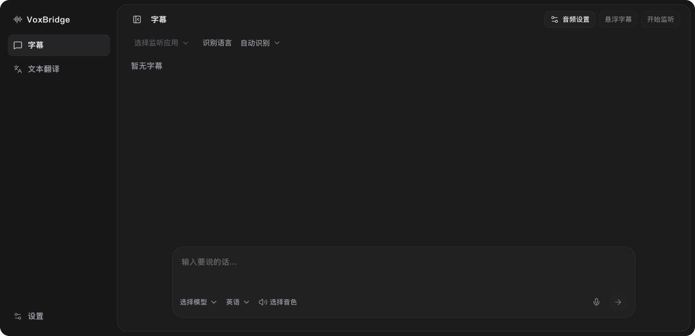
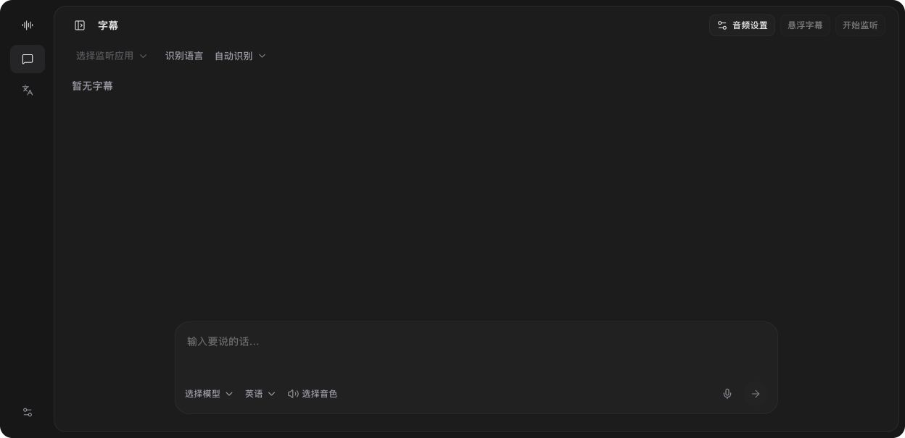
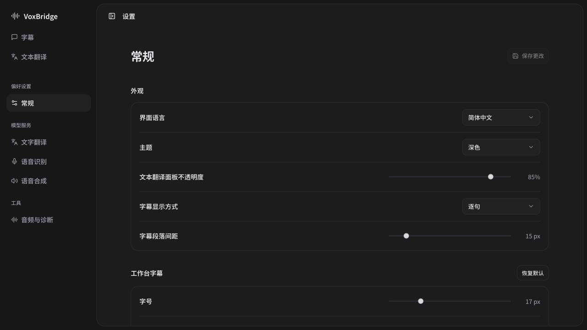
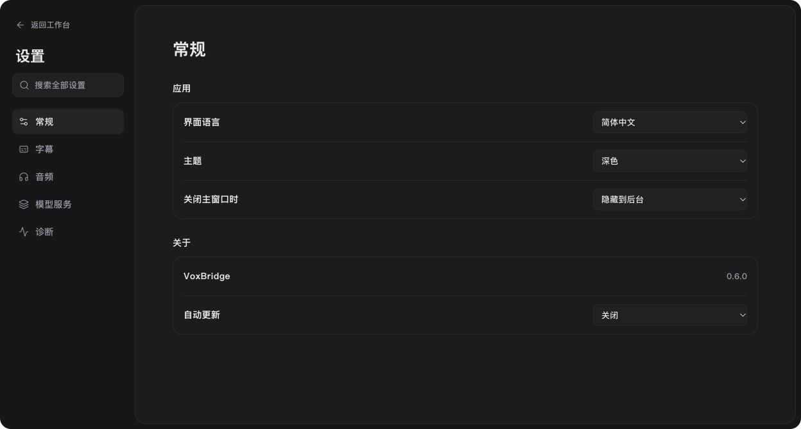
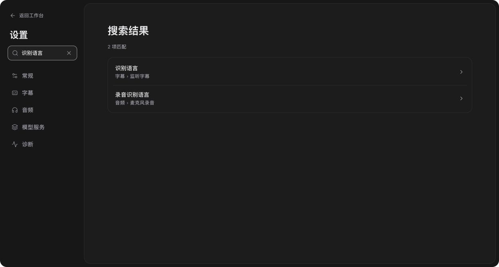

# 工作台侧栏与设置搜索原型

状态为设计留档，待开发。图中的尺寸和分类是原型中的提案，可在实现时按实际窗口空间和设置项调整。

## 工作台侧栏

「字幕」和「文本翻译」放在左栏上方，「设置」固定在左下角。两种宽度下，三个入口的顺序和选中状态一致。

### 展开

宽约 196 px，显示图标和文字。左右拖动侧栏与工作台的交界处可调整宽度。

### 收起

宽约 60 px，只显示图标，鼠标悬停和键盘聚焦时可查看入口名称。点击标题栏的侧栏按钮，或把侧栏向左拖窄至收起阈值，即可进入图标模式。再次展开时恢复上次使用的宽度，切换无需动画。

## 设置页布局

### 当前设置页

下图来自当前源码的浏览器预览。工作台入口和设置分类共用左栏，字幕相关选项也出现在「常规」中。

### 改版后的默认页

从工作台点「设置」后，左栏切换为设置导航。「返回工作台」在顶部，搜索框紧跟「设置」标题。分类暂定为常规、字幕、音频、模型服务和诊断。右侧按分类展示设置项，图中窗口行为以 macOS 文案为例。

### 搜索结果

输入关键词后，右侧直接显示所有匹配项及所属分类。比如搜索「识别语言」，可以区分监听字幕的识别语言和麦克风录音的识别语言。点结果会直接打开所属分类并高亮对应行，清除关键词会返回搜索前的分类。

## 后续验证

- 原型已验证标题栏按钮可切换侧栏、收起时可打开设置，以及返回工作台后可恢复展开宽度。鼠标拖拽的实机手感待验证。
- 实现后检查 macOS 和 Windows 的最小窗口、Windows 125% 和 150% 缩放，以及较长的英文和俄文标签。空间不足时让控件换到标签下方，并验证键盘能找到图标入口、搜索结果和对应设置项。
